# Dayline（暂定名）

本地优先、无需账号、无需订阅的个人任务与时间管理应用。目标覆盖滴答清单的核心体验，同时交付 Windows 桌面与 Web/PWA。

> 当前阶段：**v1 功能闭环（P0 + P1 主要模块）**。Web/PWA 使用 SQLite-WASM + OPFS，直接执行 `docs/specs/schema-v1.sql`；桌面端复用同一套 UI，并通过 Tauri 命令直接读写本机 SQLite 文件。Windows 安装包（MSI / NSIS）已可构建。

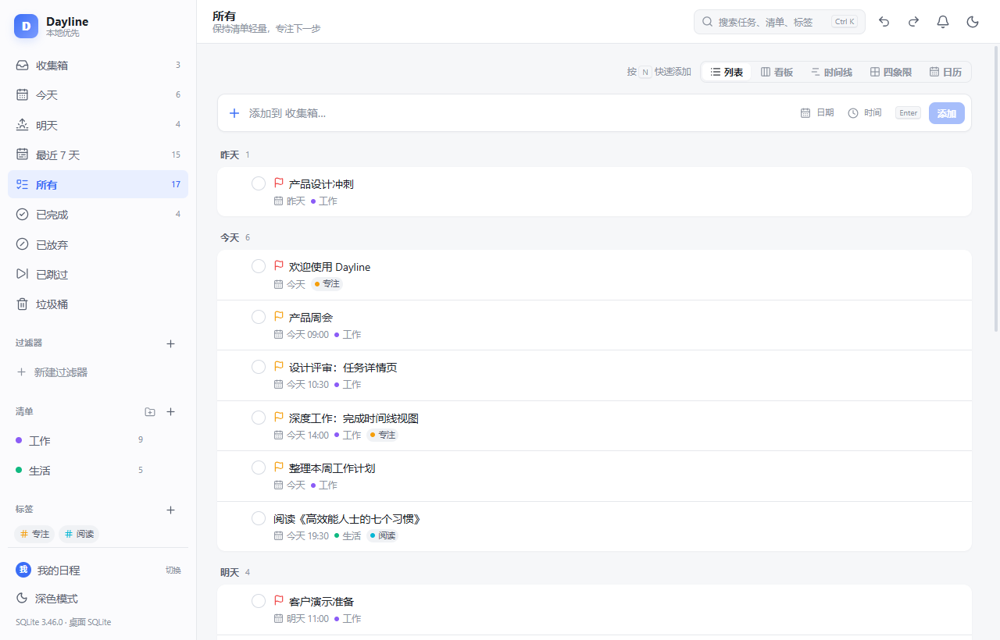

## 界面预览

| 日历 · 周视图 | 看板 |
| --- | --- |
| 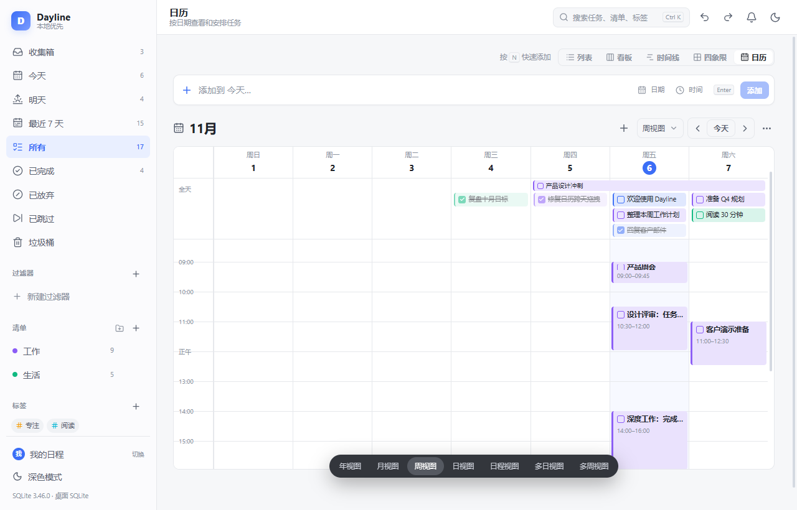 | 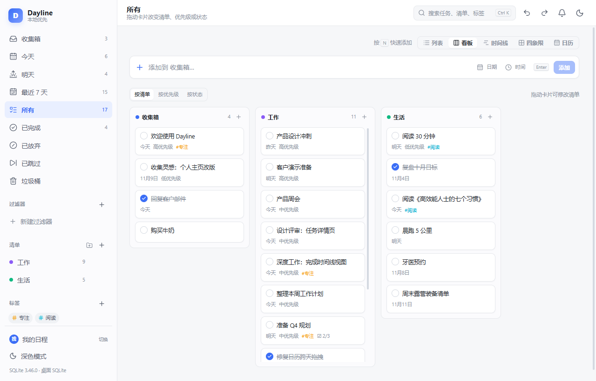 |

| 时间线 | 四象限 |
| --- | --- |
| 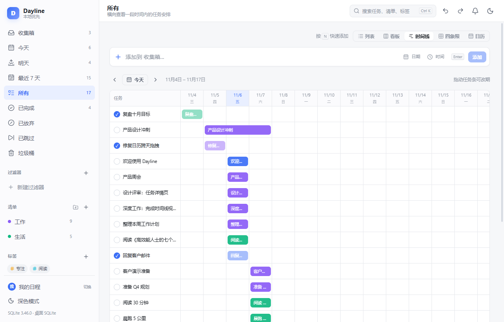 | 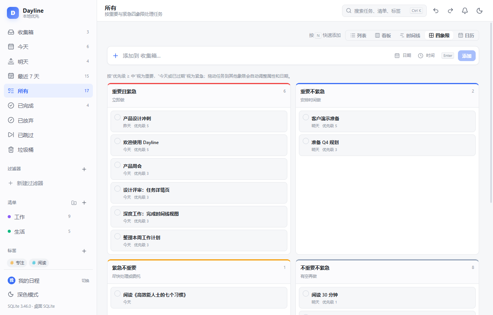 |

| 任务详情 | 专注 |
| --- | --- |
| 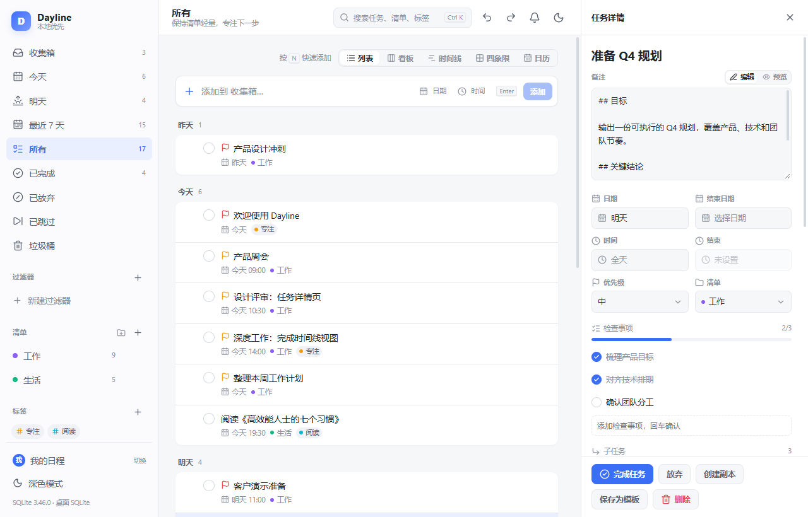 | 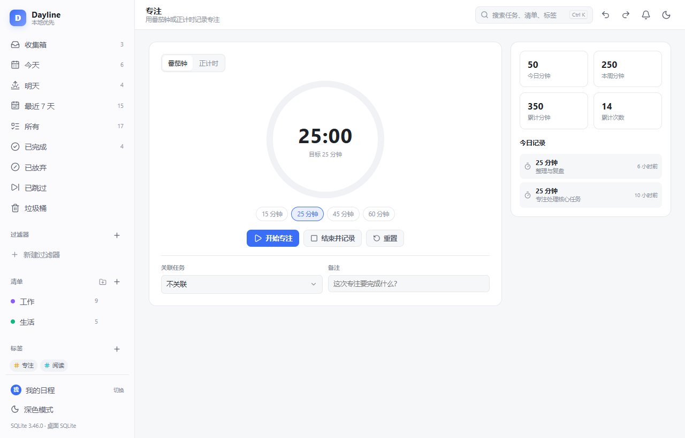 |

| 统计 | 习惯 |
| --- | --- |
| 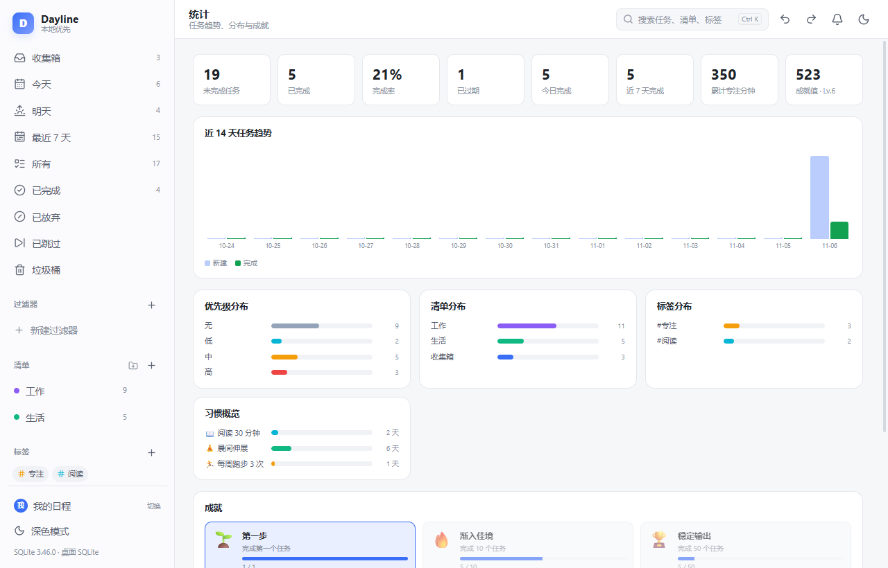 | 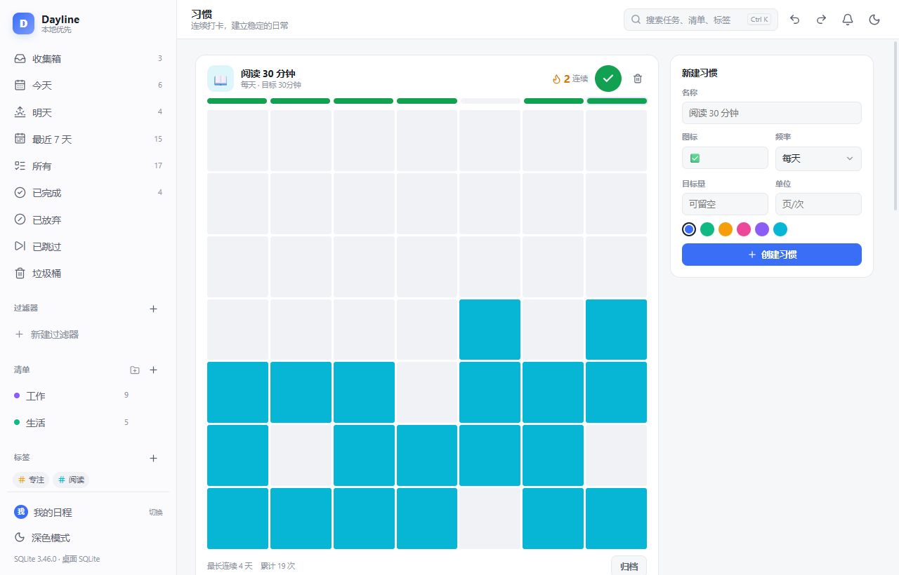 |

## 目录

```text
apps/
  web/              React + Vite + PWA（v1，桌面也复用这套 UI）
  desktop/          Tauri 2 桌面壳
packages/
  core/             领域模型、用例、纯函数（可在桌面/Web/CLI 复用）
  db/               SQLite Repository、行映射、SQL 语句
  recurrence/       重复规则展开、下一周期计算、规则测试
docs/
  research/         滴答清单帮助文档调研
  plan/             范围矩阵、路线图
  specs/            Schema、数据字典、重复规则规格
```

## 开发

```bash
npm install
npm run dev          # Web/PWA，http://127.0.0.1:5173
npm test             # 领域层单元测试
npm run build        # 构建 Web/PWA
npm run typecheck    # TypeScript 检查
```

> Windows PowerShell 如果提示 `npm.ps1` 被禁止运行，改用 `npm.cmd install`、`npm.cmd run dev`，或调整 PowerShell ExecutionPolicy。
>
> OPFS 需要 `Cross-Origin-Opener-Policy: same-origin` 和 `Cross-Origin-Embedder-Policy: require-corp`。Vite 开发/预览服务器已配置；部署到静态托管时需要自行加同样的响应头，否则会降级为内存数据库并提示。

桌面端（需要 Rust stable + Windows C++ Build Tools）：

```bash
npm run desktop:dev
npm run desktop:build
```

## AI 助手

右下角悬浮球可随时打开 AI 助手，在任意任务上右键也能直接向 AI 提问。

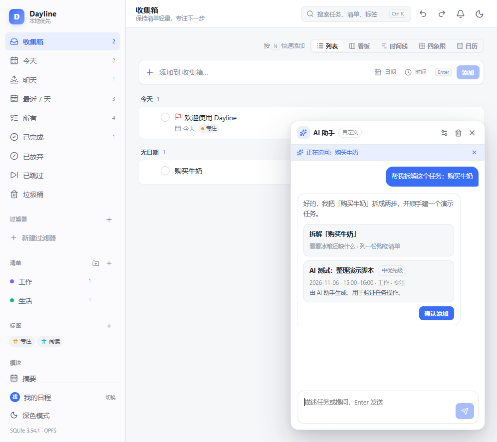

1. 打开「设置 → AI 助手」
2. 选择服务商：DeepSeek、OpenAI、Ollama 或自定义 OpenAI 兼容接口
3. 填写 API 地址、模型名、API Key（Ollama 一般留空）
4. 点「测试连接」

- 密钥只保存在本机 localStorage，不写入备份，也不会上传到其他服务器。
- 桌面端通过 Rust 代理发起请求，不受浏览器 CORS 限制。
- Web 版受浏览器 CORS 限制：使用 Ollama 时需允许跨域，或改用允许跨域的网关。
- 只有发送消息时才会把对话和（可选的）今日任务上下文发送到你配置的模型服务；使用 Ollama 本地模型时数据不离开本机。
- AI 生成的任务和子任务不会直接写入，需要点「确认添加」。

## 局域网协作（桌面端）

同一局域网内的 WishToday 桌面用户可以互相发现、建群并共享任务，不需要账号或云端服务器。

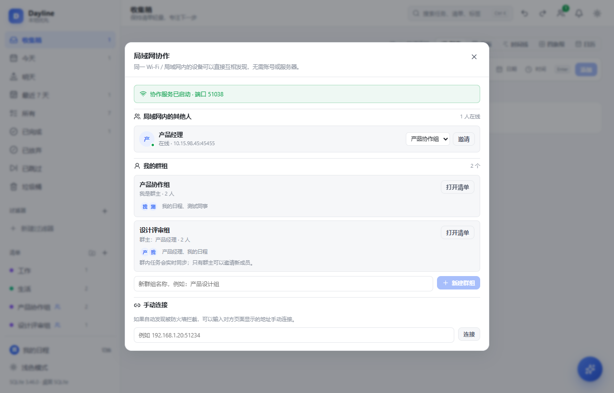

- 顶栏「协作」按钮 → 查看在线设备，创建群组并邀请成员
- 对方同意后，群组会以清单的形式出现在他的侧边栏
- 群内任务实时同步，所有成员可见；任务详情里可以「关联成员」
- 支持自动发现；如果被防火墙拦截，也可以手动输入对方的 `IP:端口` 连接
- 同一台电脑上开两个客户端测试时，用协作面板里显示的 `127.0.0.1:端口` 手动连接
- 每个本地用户拥有独立的设备身份，切换用户后其他人会看到新的设备
- 首次使用请在 Windows 防火墙中允许应用访问专用网络
- 群组数据以群主为中转同步，群主离线时新修改会等待其上线后继续
- 传输内容是明文 JSON，仅建议在可信局域网使用；邀请需要对方确认，群消息带群组 token
- Web/PWA 版本暂不支持局域网协作（浏览器无法监听端口）

## 当前实现范围

- **用户管理**：侧边栏底部可创建、切换、重命名、删除用户；每个用户使用独立的 SQLite 数据库文件（OPFS）或独立的 localStorage 键（HTTP 回退），任务、清单、标签、习惯、专注、备份互不影响。
- 左栏智能清单：收集箱、今天、明天、最近 7 天、所有、已完成、已放弃、已跳过、垃圾桶。
- 文件夹 + 清单：创建/折叠/删除文件夹，清单可归入文件夹；清单可编辑名称、颜色、类型（任务/笔记）。
- 标签管理：创建、重命名、颜色、删除；标签视图；标签可跨清单筛选。
- 任务快速添加：支持在快速添加栏直接选择日期和时间；任务完成时复刻滴答清单的勾选、淡出、移除节奏。
- 任务详情：标题、Markdown 备注（编辑/预览）、日期/结束日期/时间、优先级、所属清单、子任务、检查事项、附件、评论、重复、多提醒、标签。
- **附件**：OPFS / IndexedDB 内容寻址存储，支持图片预览、下载、删除清理、旧 Data URL 自动迁移；JSON 备份会内联附件。
- **数据可靠性**：SQLite 临时 I/O/锁错误自动重试；设置页可检查数据库完整性；恢复备份前自动创建快照。
- **批量操作 + 撤销/重做**：多选任务后批量完成/恢复/删除/移动清单/改优先级/加标签；`Ctrl+Z` / `Ctrl+Shift+Z` 覆盖任务、批量、导入和备份恢复。
- **拖动**：列表中把任务拖到另一个任务上生成子任务（带 5 级与循环校验），拖到侧边栏清单可移动清单。
- **子任务 + 检查事项 + 进度**：子任务可创建/完成/打开；检查事项可勾选、删除，进度自动计算，全部完成时主任务自动完成。
- **任务链接**：Markdown 中使用 `[[任务标题]]`，在详情预览/评论中点击可跳转。
- **任务模板**：当前任务可保存为模板，模板对话框可一键创建任务。
- **全局搜索**：`Ctrl+K` 搜索任务、清单、标签。
- **保存过滤器**：标题/备注/清单/标签/优先级/状态/日期条件，支持“满足全部/任一”，可保存、编辑、删除。
- **日历七种视图**：日/周/月/年/日程/多日/多周；周日开始、今天蓝色圆形、当前时间线；显示时段可配置（默认 08:00–21:00）并持久化。
- **看板视图**：按清单/优先级/状态分组，拖动卡片改属性。
- **时间线视图**：横向 14 天时间轴，任务条拖动改期，未安排任务可拖入日期。
- **四象限视图**：按优先级与日期自动划分重要/紧急，拖动任务改优先级与日期。
- **农历/节日标签**：月视图显示春节/元宵/清明/端午/中秋/教师节/国庆等主要节日，并用 `休` / `班` 标记 2026 年法定放假与调休上班日。
- **拖拽排期**：周/月/多周拖动任务改日期；日/周/多日拖到时间网格改开始时间；拖动时间块底边改结束时间。重复任务拖动/改时间会写入“仅此周期”覆盖，不改变系列规则；详情中可“跳过此周期”或“恢复默认时间”。
- **跨天任务**：支持结束日期；月视图/全天行按天分段连续显示，跨天时间块分段渲染；拖动跨天任务会整体平移结束日期。
- **多提醒 + 稍后提醒 + 提醒中心**：准时/提前 5/10/30/60 分钟/1 天，可叠加多条；触发后 toast/系统通知，可 10 分钟后再提醒或忽略；顶栏提醒中心集中处理。
- **重复任务**：每天/每周/每月/每年/每个工作日/每周末/法定工作日/法定节假日/艾宾浩斯/自选日期；间隔、自定义星期、每月日期、结束日期/次数、按到期日/完成后重复；2026 年调休数据已内置；跳过/恢复/自动合并。
- **笔记**：清单可切换为笔记类型，内置 Markdown 编辑/预览。
- **专注**：番茄钟/正计时、15/25/45/60 分钟、关联任务、备注、当日记录与累计统计。
- **习惯**：每天/每周指定/间隔天数、目标量与单位、今日/最近 7 天打卡、连续与最长连续、49 天热力图、归档。
- **纪念日**：公历/农历、每年重复、倒数/正数、岁数；农历日期自动换算下一次公历日期。
- **摘要**：近 7/14/30 天完成、新建、专注分钟、习惯打卡、每日节奏、清单贡献。
- **统计/成就**：任务趋势、完成率、优先级/清单/标签分布、习惯概览、成就值与 8 个成就。
- **备份与恢复**：JSON 完整备份、CSV 任务表、ICS 日历导出；JSON/CSV/ICS 导入；浏览器本地每日自动备份与恢复。
- **AI 助手**：右下角悬浮球打开对话面板；在任意任务上右键可「问 AI 助手」。支持自然语言创建任务、为已有任务拆解子任务，写入前需要确认。兼容 DeepSeek / OpenAI / Ollama / 任意 OpenAI 兼容接口。
- **局域网协作**：桌面端自动发现同一局域网内的其他用户，支持建群（共享清单）、邀请/同意、群内任务实时同步和任务关联成员；无需账号和服务器。
- **设置页**：主题、日历显示时段、通知权限、AI 模型配置、快捷键说明。
- **本地持久化**：Web/PWA 使用 SQLite-WASM + OPFS，通过 Worker 执行 `schema-v1.sql`；FTS5 可用。桌面端通过 Tauri 的 `db_open/db_all/db_run/db_batch` 命令直接读写本机 SQLite，数据库位于 `%APPDATA%\com.dayline.desktop\`，每个本地用户一个文件。
- OPFS 不可用时降级为内存数据库并提示；桌面端只有在原生 SQLite 驱动不可用时才回退到 localStorage，并在首次成功连接后自动迁移缓存中的任务。
- 桌面端不注册 PWA Service Worker，避免 `tauri.localhost` 缓存旧构建；升级时会自动清理旧 Service Worker 缓存。
- 浅色/深色主题。
- 领域层/数据层/重复引擎/过滤器/备份单元测试；真实浏览器验证新增/完成/删除/恢复/重复生成/习惯打卡/专注记录/撤销重做/刷新持久化。

开发辅助：访问 `http://127.0.0.1:5173/?reset=1` 会清空本地数据库并重新播种示例数据（仅 dev）。

> 提醒限制：浏览器关闭后无法保证系统通知；当前调度器在页面打开时每 30 秒扫描一次，启动时会补发已到期提醒。桌面端后续接入原生通知/托盘常驻。
>
> 体积：农历库已改为按需加载；主 JS 约 453KB（gzip 129KB），农历 chunk 约 301KB（gzip 102KB），只在打开月视图时下载。

## 已确认的产品决策

- Windows 桌面 + Web/PWA 都在 v1。
- 时间线视图 v1 Must。
- 多档案/本地多用户：v1 已提供“本地用户管理”，每个用户独立数据库；跨设备账号/云端多档案仍在 v2。
- 视觉语言与滴答清单一致（布局/密度/交互），但 Logo、图标、插画、文案、主题资产原创。
- 不做账号、会员、官方云同步、共享协作。

## 目录说明

- `docs/plan/v1范围矩阵.md`：v1 范围与发布出口。
- `docs/plan/实现状态-2026-11-06.md`：P0/P1 实现状态、验证结果与已知限制。
- `docs/specs/数据字典与Schema-v1.md`：数据模型。
- `docs/specs/schema-v1.sql`：SQLite DDL。
- `docs/specs/重复规则规格.md`：重复任务规则。
- `docs/specs/法定节假日数据.md`：2026 年放假/调休数据与更新流程。

## 下载

Windows 安装包（MSI / NSIS）见 [Releases](https://github.com/sixiaozhe/WishToday/releases)。也可以直接使用 Web 版，或用源码构建。

## 许可

[MIT](LICENSE)
